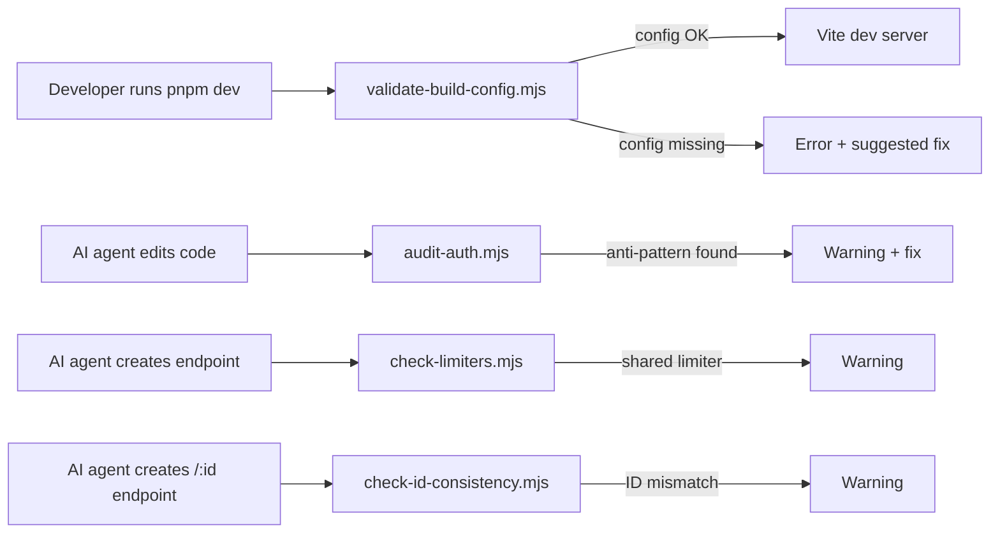

# Design — OLA 1: Skills Preventivas (Type Contracts)

> Spec-Driven Development · Phase 3 · Artifact
> Define estructura de carpetas, firmas de scripts (JSDoc), y grafo de cross-references.
> Los scripts son `.mjs` (Node ESM, no parte del build de la app) — tipado via JSDoc.

## Folder Structure por Skill

```
.opencode/skills/
├── build-config-validator/
│   ├── SKILL.md
│   └── scripts/
│       └── validate-build-config.mjs
├── frontend-debugging-protocol/
│   ├── SKILL.md
│   └── references/
│       └── diagnostic-tree.md
├── auth-flow-audit/
│   ├── SKILL.md
│   ├── references/
│   │   └── audit-checklist.md
│   └── scripts/
│       └── audit-auth.mjs
├── rate-limiting-design/
│   ├── SKILL.md
│   ├── references/
│   │   └── tier-table.md
│   └── scripts/
│       └── check-limiters.mjs
├── api-response-normalizer/
│   ├── SKILL.md
│   ├── references/
│   │   └── envelope-convention.md
│   └── scripts/
│       └── check-id-consistency.mjs
├── prisma-frontend-types/
│   ├── SKILL.md
│   ├── references/
│   │   └── type-mapping-rules.md
│   └── scripts/
│       └── generate-frontend-types.mjs
├── nodejs-module-loading/
│   ├── SKILL.md
│   ├── references/
│   │   └── esm-evaluation-order.md
│   └── scripts/
│       └── check-env-loading.mjs
├── lazy-loading-patterns/
│   ├── SKILL.md
│   ├── references/
│   │   └── lazy-patterns.md
│   └── scripts/
│       └── check-module-level-loads.mjs
```

**Conteo**: 8 SKILL.md + 7 references/*.md + 6 scripts/*.mjs = 21 archivos nuevos.

---

## Shared Script Utilities

Los 6 scripts comparten patrones comunes. Para mantener DRY, un helper compartido:

```
.opencode/skills/_shared/
└── script-utils.mjs
```

> `_shared/` con underscore prefix para que `skill-validator` lo ignore (no es una skill).

### `script-utils.mjs` — Firmas JSDoc

```javascript
/**
 * @typedef {Object} Issue
 * @property {"error"|"warning"|"info"} severity
 * @property {string} check
 * @property {string} msg
 * @property {string} [file]
 * @property {number} [line]
 */

/**
 * @typedef {Object} ScriptResult
 * @property {Issue[]} issues
 * @property {number} errors
 * @property {number} warnings
 * @property {number} info
 * @property {boolean} ok
 */

/**
 * Walk all files matching a glob-like pattern (recursive).
 * @param {string} dir
 * @param {(name: string) => boolean} filter
 * @returns {string[]}
 */
export function walkFiles(dir, filter) { ... }

/**
 * Read file as UTF-8 string, stripping BOM if present.
 * @param {string} filePath
 * @returns {string}
 */
export function readFileUtf8(filePath) { ... }

/**
 * Format and print a ScriptResult to console.
 * @param {ScriptResult} result
 * @param {string} scriptName
 */
export function printResult(result, scriptName) { ... }

/**
 * Exit with code based on result (0 if ok, 1 if errors).
 * @param {ScriptResult} result
 */
export function exitFromResult(result) { ... }

/**
 * Parse frontmatter from a markdown file.
 * @param {string} content
 * @returns {{ front: string, body: string } | null}
 */
export function parseFrontmatter(content) { ... }
```

---

## Script Contracts Individuales

### 1. `build-config-validator/scripts/validate-build-config.mjs`

```javascript
/**
 * @typedef {Object} ConfigCheck
 * @property {string} file
 * @property {(content: string, dir: string) => Issue[]} validate
 */

/**
 * @typedef {Object} BuildConfigOptions
 * @property {string} [webDir]
 * @property {boolean} [fix]
 */

/**
 * Validate build config files exist and are correct.
 * @param {BuildConfigOptions} [opts]
 * @returns {Promise<ScriptResult>}
 */
export function validateBuildConfig(opts) { ... }
```

**Checks**: postcss.config.{js,cjs,mjs} existe + plugins tailwindcss/autoprefixer; tailwind.config.{js,cjs,ts} existe + DEFAULT en paletas; vite.config.{ts,js} existe; tsconfig.base.json existe.

### 2. `auth-flow-audit/scripts/audit-auth.mjs`

```javascript
/**
 * @typedef {Object} AuthAntiPattern
 * @property {string} pattern
 * @property {string} severity
 * @property {string} fix
 */

/**
 * Scan codebase for auth anti-patterns.
 * @param {string} [rootDir]
 * @returns {Promise<ScriptResult>}
 */
export function auditAuth(rootDir) { ... }
```

**Anti-patterns detectados**: `localStorage.setItem.*token`, `sessionStorage.*token`, `window.location.*=.*login` en archivos con `interceptor`, store con `persist` + campo `token`, `setToken` en store sin `getMe`.

### 3. `rate-limiting-design/scripts/check-limiters.mjs`

```javascript
/**
 * @typedef {Object} RouteLimiterInfo
 * @property {string} file
 * @property {string} path
 * @property {string} [limiter]
 */

/**
 * Detect shared rate limiters between auth-login and session endpoints.
 * @param {string} [apiDir]
 * @returns {Promise<ScriptResult>}
 */
export function checkLimiters(apiDir) { ... }
```

**Detecta**: mismo `rateLimit` import aplicado a `/auth/login` + `/auth/me`; limiter sin `skip` function; `windowMs` < 1min en endpoints de sesión.

### 4. `api-response-normalizer/scripts/check-id-consistency.mjs`

```javascript
/**
 * @typedef {Object} EndpointIdInfo
 * @property {string} file
 * @property {string} route
 * @property {string} paramId
 * @property {string} [whereField]
 */

/**
 * Detect endpoints where req.params.id is used in where: { <otherField>: id }.
 * @param {string} [apiDir]
 * @returns {Promise<ScriptResult>}
 */
export function checkIdConsistency(apiDir) { ... }
```

**Detecta**: `req.params.id` usado en `where: { userId: id }` (mismatch); `req.params.userId` usado en `where: { id }` (mismatch inverso); endpoints `/:id` sin `where` visible (posible raw SQL sin check).

### 5. `prisma-frontend-types/scripts/generate-frontend-types.mjs`

```javascript
/**
 * @typedef {Object} PrismaField
 * @property {string} name
 * @property {string} type
 * @property {boolean} optional
 * @property {boolean} isRelation
 * @property {string[]} [relationModels]
 */

/**
 * @typedef {Object} PrismaModel
 * @property {string} name
 * @property {PrismaField[]} fields
 */

/**
 * @typedef {Object} GenerateOptions
 * @property {string} [schemaPath]
 * @property {string} [outputPath]
 */

/**
 * Parse schema.prisma and generate frontend-safe TS types.
 * @param {GenerateOptions} [opts]
 * @returns {Promise<ScriptResult & { types?: string }>}
 */
export function generateFrontendTypes(opts) { ... }
```

**Mapeo Prisma → TS**: String→string, Int→number, Boolean→boolean, DateTime→string (ISO), Json→unknown, Enum→union, Relation→T[] (si array) | T (si single).

### 6. `nodejs-module-loading/scripts/check-env-loading.mjs`

```javascript
/**
 * @typedef {Object} EnvLoadingIssue
 * @property {string} file
 * @property {string} importChain
 * @property {string} problem
 */

/**
 * Detect dotenv.config() called too late in the import chain.
 * @param {string} [srcDir]
 * @returns {Promise<ScriptResult>}
 */
export function checkEnvLoading(srcDir) { ... }
```

**Detecta**: `dotenv.config()` en archivo que no sea primer import; `process.env` leído en módulo sin importar `dotenv/config` antes; uso de `import "dotenv/config"` correcto (info, no warning).

### 7. `lazy-loading-patterns/scripts/check-module-level-loads.mjs`

```javascript
/**
 * @typedef {Object} ModuleLevelLoad
 * @property {string} file
 * @property {string} call
 * @property {number} line
 * @property {string} fix
 */

/**
 * Detect heavy library calls at module level (outside hooks/components).
 * @param {string} [srcDir]
 * @returns {Promise<ScriptResult>}
 */
export function checkModuleLevelLoads(srcDir) { ... }
```

**Detecta**: `loadStripe(`, `new Map(`, `L.map(` fuera de funciones/hooks/componentes; calls a nivel de módulo (top-level) en archivos `.tsx`/`.ts`.

---

## Cross-Reference Graph

```
build-config-validator ──────────────► frontend-debugging-protocol
                                           │
                                           ▼
auth-flow-audit ──────────► jwt-bcrypt   api-response-normalizer ──► prisma-frontend-types
                                           │
                                           ▼
rate-limiting-design ─────► api-design   frontend-debugging-protocol

nodejs-module-loading ─────► env-management

lazy-loading-patterns ─────► react-vite
```

**Refs bidireccionales** (ambos SKILL.md se referencian):
- `frontend-debugging-protocol` ↔ `build-config-validator`
- `frontend-debugging-protocol` ↔ `api-response-normalizer`
- `api-response-normalizer` ↔ `prisma-frontend-types`

**Refs a skills existentes** (unidireccional, nuevas → existentes):
- `auth-flow-audit` → `jwt-bcrypt`
- `rate-limiting-design` → `api-design`
- `nodejs-module-loading` → `env-management`
- `lazy-loading-patterns` → `react-vite`
- `prisma-frontend-types` → `prisma-orm`
- `build-config-validator` → `tailwindcss`, `react-vite`

---

## Mermaid — Data Flow of Script Execution



---

## Decision Log Entry

```
[2026-06-17] OLA 1 Phase 3 Design aprobado. 8 skills con 6 scripts .mjs + 7 references. Helper compartido en _shared/script-utils.mjs. Grafo de cross-refs definido. Artefacto: retoques/openspec/changes/ola1-preventive-skills/design.md
```
